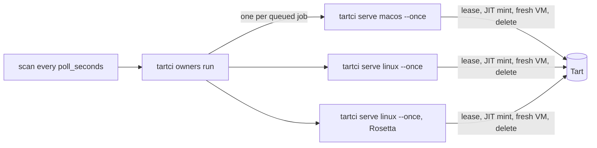

# Owner-wide runner pool

Status: **polling pool implemented** (PRs 1–3 in [Delivery](#delivery)).
Push discovery through `gh webhook forward` is PR 4 and not built yet; until
it lands the pool polls. The choices behind the design are in
[Decisions](#decisions).

## Problem

tartci serves GitHub Actions from per-repository lanes. Each lane names one
`TARTCI_RUNNER_REPO`, one golden and the exact workflows it may serve, and
`fleet-macos` profiles declare those lanes host by host. That fits a few
known repositories. It does not fit an operator who wants one Mac to serve
**every** private repository of some owners, including a personal account:

- A user account (as opposed to an organization) has no account-level
  runners, so each repository needs its own repository-scope JIT runner.
- The operator does not want to list workflow names. A job opts in through
  its `runs-on` label alone.
- New repositories should be served without editing a profile.

## Outcome

One LaunchAgent, started at login, serves queued jobs from the **private**
repositories of configured owners on three platform lanes, with a
configurable cap on concurrent jobs:

| Label | Guest | Golden | How |
| --- | --- | --- | --- |
| `macos-a64` | macOS arm64 | `owners-macos` | macOS serving lane |
| `linux-a64` | Linux arm64 | `owners-linux` | Linux serving lane |
| `linux-x64` | Linux arm64 + Rosetta | `owners-linux` | Linux lane booted with `TARTCI_LINUX_ROSETTA=1`, x64 runner |

Labels come from the lanes and are not configured. Every runner carries
`self-hosted` plus exactly one lane label. A workflow opts in with
`runs-on: [self-hosted, linux-x64]` or `runs-on: linux-x64`. A job is served
only when its labels, compared case-insensitively, are a subset of
`{self-hosted, <lane label>}` for one lane. A job that also asks for another
label (`[self-hosted, linux-x64, gpu]`) could never be taken by a pool
runner, so it is not served rather than booting a VM for it every 120 s.

`macos-x64` is out of scope: there is no x64 macOS guest on Apple silicon.

In a `linux-x64` job only the runner and the x64 binaries a step starts run
under Rosetta. The job's shell is the guest's arm64 bash: `uname -m` prints
`aarch64` while `RUNNER_ARCH` is `X64`. Use the label to get an x64 toolchain
(actions that download x64 builds, x64 Node for JavaScript actions), not to
emulate a whole x64 machine.

## Set up

Needs an Apple Silicon Mac with tartci's prerequisites (`./tartci doctor`),
a `gh` login in the keychain that is an admin of every repository to serve
(repository-scope JIT registration needs admin), and about 250 GB free for
the two goldens and their base images (the macOS golden is about 97 GB on
the host, its Xcode base about 89 GB, the Linux golden about 15 GB).

1. **The VM key and goldens.** Both goldens trust one host key,
   `~/.config/tartci/owners-vm-ed25519` (created on first use). Both build
   into `TART_HOME=~/.tart`, the store the agent uses. Export it first: the
   scripts only default it when it is unset, and the agent always uses
   `~/.tart`.

   ```bash
   export TART_HOME=~/.tart
   providers/tart-macos/owners-golden.sh            # -> owners-macos
   providers/tart-linux/owners-golden.sh            # -> owners-linux
   ```

   Both scripts pull their digest-pinned base image themselves (a no-op when
   it is already in the store). The macOS golden is Cirrus's
   `macos-golden-gate-xcode` (macOS 27, Homebrew, Xcode) pinned by digest,
   plus the pinned actions runner; the digest is the image the `:latest` tag
   resolved to when the script was written, and it is printed in the build's
   metadata line. The Linux golden is digest-pinned Ubuntu 24.04 arm64 with
   the arm64 and x64 runners, the amd64 libraries x64 binaries need, and a
   boot unit that registers Rosetta when the share is attached. Both carry
   the toolset of GitHub's hosted images, so a job that passes on a
   GitHub-hosted runner finds the same commands (see
   [Golden toolset](#golden-toolset)). No token enters either golden.
   Both scripts end by locking the VM down (see [Security](#security)).
   With the base image already pulled, a full build took about 7 minutes for
   Linux and about 6 for macOS on this pool's host. The first macOS build
   also pulls the Xcode base, about 89 GB on disk.

   To rebuild a golden, pass `--rebuild` (the macOS script also accepts
   `--force`). The new golden is built under a temporary name and swapped in
   with `tart rename` only after every step, including the lock-down checks,
   passed, so a failed rebuild leaves the pool's golden as it was. An
   interrupted swap is put back by the script's exit handler. A build killed
   outright (`kill -9`, power loss) can leave an `owners-*-build-<pid>` or
   `owners-*-old-<pid>` VM: the next run lists them and leaves them for you to
   delete. Stop the pool (`tartci owners uninstall`) before a rebuild, so no
   child clones the golden mid-swap.

2. **The host's lease budget.** Each child leases its VM from tartci's host
   lease store. Its size is a ceiling, not a reservation: the guest boots at
   the size step 3 sets per OS, but the lease charges at most `1/max_jobs` of
   the host's non-gate budget on each axis (`non_gate_capacity_cores` and
   `non_gate_capacity_mem_mb`, shown by `./tartci host-profile --json`), and a
   child waiting for capacity holds room for that share only. So `max_jobs`
   children always fit together, and `max_jobs` alone caps how many run, never
   the sum of their sizes. With no size set, a child boots at what any serve
   on this host asks: the host profile's cores (`vm_pool_cores` in the same
   output), clamped to the non-gate core budget, and memory derived from the
   cores it is granted (`providers/common/vm-lease.lib.sh`); its lease charges
   the same share. Gate leases are never discounted, so a host whose role
   reserves cores for gate jobs keeps that reserve, and the pool's shares come
   from what is left. To give the pool the whole host, release the reserve:

   ```bash
   ./tartci governor set gate_guarantee_cores=0   # optional
   ./tartci leases status        # e.g. 0/14 cores used (reserved gate 0)
   ```

3. **The config,** `~/.config/tartci/owners.toml`:

   ```toml
   owners = ["alvis", "theriety"]  # users or organizations
   repos = []                # extra private owner/repo entries
   exclude_repos = []
   max_jobs = 4              # concurrent jobs, 1-16
   max_macos = 2             # 0-2; Apple's guest limit is 2
   poll_seconds = 10         # scan interval; widened on its own when rate headroom is low
   gh_cli = "gh"             # the GitHub CLI the dispatcher and its children run (default "gh")
   # macos_vm_cores = 4      # child VM size per OS, cores 1-64, memory 2048-524288 MB;
   # macos_vm_mem_mb = 10240 # a key left unset leaves the lane's own sizing (step 2)
   # linux_vm_cores = 3
   # linux_vm_mem_mb = 8192
   # reconcile_seconds and push are read but unused until push lands (PR 4)

   [golden]                  # optional; these are the defaults
   macos-a64 = "owners-macos"
   linux-a64 = "owners-linux"
   linux-x64 = "owners-linux"
   ```

   `gh_cli` names the GitHub CLI the dispatcher, its reap pass and every
   child run (exported to children as `TARTCI_GH_CLI`; `install` also puts its
   directory on the agent's `PATH`). Leave it at `gh` unless the login lives
   behind a wrapper. It must authenticate from the keychain, with
   `GH_TOKEN` and `GITHUB_TOKEN` scrubbed. Unknown keys are an error, so a
   typo never silently changes behaviour.

4. **Check, then install.**

   ```bash
   ./tartci owners dry-run       # what would be served, per owner and repo; starts nothing
   ./tartci owners install       # pin this commit, write and load the LaunchAgent
   ./tartci owners status        # repositories, children, child VM size, rate headroom, pinned commit
   ```

   `install` exports the checkout's committed `HEAD` (under jj, the parent of
   the working-copy change) to `~/.tartci/owners/app/<sha>/` and the agent
   runs that copy, never the working tree. To update, check out the new
   reviewed commit and run `install` again.

A workflow then opts in:

```yaml
jobs:
  build:
    runs-on: [self-hosted, linux-x64]
```

## Shape



The dispatcher, `tartci owners`:

```text
tartci owners run         # the LaunchAgent's process
tartci owners dry-run     # print what would be served, start nothing
tartci owners status      # repositories, children, headroom, pinned commit
tartci owners install     # pin a commit, write and load the LaunchAgent
tartci owners uninstall   # unload and remove it; keep goldens and config
```

It is `scripts/owners_dispatch.py` (with `scripts/owners_service.py` for the
service), run through `tartci_toml_exec` so it can read TOML, with unit tests
under `scripts/test_owners_*.py`. The name avoids the existing `fleet` and
`fleet-macos` vocabulary. [docs/agents/commands.md](agents/commands.md) has
the exact behaviour and exit codes of each subcommand.

The dispatcher decides which repository and lane needs a runner next and hands
that to `tartci serve <os> --once --repo R --labels self-hosted,<label>
--golden G`. Everything after that is tartci as it is today: lease admission,
JIT registration at repository scope (group 1), a throwaway clone, one job,
and deletion.

### Admission stays with tartci

The dispatcher adds an outer cap. It does not replace the inner one:

- `max_jobs` (default 4) bounds concurrent `serve --once` children. At most 2
  of those are macOS (`max_macos`, and never more than
  `TARTCI_MACOS_VM_CAP`). Apple's 2-guest limit and the host lease store
  still decide inside each child.
- Before starting a child, the dispatcher checks the same two gates the
  macOS lane checks, `tartci_pool_admission_open` and
  `tartci_pool_lock_absent` from `providers/common/pool.lib.sh`. While either
  is closed it starts nothing and lets running children finish, so
  `tartci pool drain` drains the pool too.
- A child refused before boot (lease denied, admission closed or the macOS
  cap full) exits without a VM, and the job stays queued. The dispatcher
  backs off that `(repo, lane)` with a growing delay instead of retrying
  every tick. A child that booted but was never given a job (120 s idle
  timeout) gets a short fixed pause instead.

### Children

- **Identity.** Each child gets its own name (`tartci-owners-…`), slot, lane
  ID and state directory under `~/.tartci/owners/state/`. macOS children
  register as `tartci-owners-<…>-<pid>-<n>`; Linux children as
  `linux-ephr-<pid>-<n>`.
- **Counting.** GitHub gives a runner any queued job whose labels match. So
  the dispatcher starts a child for a `(repo, label)` only while queued jobs
  outnumber that pair's children that are **not yet assigned** a job. A
  child counts as assigned once tartci writes its `job-running` state.
- **Idle timeout.** Children run with `TARTCI_RUNNER_IDLE_TIMEOUT_SECS=120`
  instead of the default 900, so an unclaimed macOS child does not hold one
  of only 2 slots for 15 minutes.
- **Size.** The pool fixes no VM size. Each `*_vm_cores` / `*_vm_mem_mb` key
  set in `owners.toml` reaches that OS's children as the lane's documented
  override (`TARTCI_{MACOS,LINUX}_VM_{CORES,MEM_MB}`); a key left unset passes
  nothing, so the lane sizes the VM as it does for any serve. That size is a
  ceiling: each child's lease charges a `1/max_jobs` share of the non-gate
  budget (`TARTCI_VM_LEASE_SHARE_SLOTS`, step 2), so jobs can burst to it
  without the sizes capping concurrency. `status` and `dry-run` print, per
  OS, the size its children request: the configured value, or the lane
  default that applies.
- **Environment.** Children get an allowlisted environment (`PATH`, `HOME`,
  `USER`, `LOGNAME`, `SHELL`, `TMPDIR`, `TERM`, `GH_CONFIG_DIR`,
  `XDG_CONFIG_HOME`, `TARTCI_MACOS_VM_CAP`) plus what the dispatcher sets:
  `TART_HOME=~/.tart`, the VM key, explicit state, cache and log
  directories, the VM size `owners.toml` sets, if any, and the share slot count
  (`TARTCI_VM_LEASE_SHARE_SLOTS` = `max_jobs`). No token, no ssh agent, no
  inherited `TARTCI_*`, `PULP_*`, `LANG`, `LC_*` or `TZ`.
- **Restart.** A child still alive when the dispatcher restarts is adopted
  only if its pid and recorded start time both match, and it counts against
  the caps. Anything that cannot be verified is never signalled.

### Repositories

- The served set is the **private, non-archived** repositories of `owners`,
  plus private `repos`, minus `exclude_repos`, listed again every 15
  minutes. A public repository is never served, even when listed by hand,
  and `status` reports it as refused.
- Each repository is checked before it is served: admin rights, not
  archived or disabled, and "Run workflows from fork pull requests" off. A
  repository that fails is refused and listed in `status`.

### Discovery

Each served repository is scanned every `poll_seconds`. A scan sends one
conditional request for the repository's metadata and one for its recent
runs (`If-None-Match`, so an unchanged answer is a 304 and costs nothing
against the primary limit). For each run that is queued or in progress it
lists the queued jobs and keeps those whose labels fit one lane. A failed
scan is an error, never "0 queued", and starts nothing.

The same `gh` login also serves tartci's own lanes, so the dispatcher tracks
headroom from `X-RateLimit-Remaining`, widens the interval on its own below
25% headroom (up to 900 s), honours `Retry-After` and secondary limits, and
shows the headroom in `status`. Across 94 repositories a dry run measured
about 2 requests per repository per scan, most of them 304s.

Push (PR 4) will add `gh webhook forward` as a hint that triggers an
immediate scan; the scan stays the truth.

### Security

- **Private repositories only.** Public repositories, where fork pull
  requests can trigger workflows, are never served. Keep "Run workflows
  from fork pull requests" off for private repositories (GitHub's default).
- **Security drops.** If a served repository turns public, its fork setting
  turns on, or any non-completed run's head repository differs from the
  base repository (or is unknown), the repository is dropped at once. Its
  waiting children, and those assigned in the last 15 s, are stopped; on a
  fork-headed run the dispatcher also reads that run's jobs and stops the
  child holding one, assigned or not (every child of the repository if the
  jobs cannot be read). This guard keeps running every scan for a dropped
  repository until its children are gone. Other drops (archived, admin lost,
  a setting unreadable) only stop new children; waiting ones expire.
- **The GitHub token stays on the host.** The dispatcher and its children use
  the keychain `gh` login only (`GH_TOKEN` and `GITHUB_TOKEN` are scrubbed,
  so the dispatcher and children always authenticate the same way). Only
  the one-job JIT config enters a VM: it is sent over ssh stdin, read and
  deleted in the guest, and handed to the runner in its environment.
- **Key-only SSH into pool VMs.** The serving lanes reach a guest with
  `BatchMode=yes` and the pool key (`TARTCI_VM_SSH_KEY`) only. The golden
  scripts use the base images' public `admin`/`admin` password just until the
  key is installed, then, as their last step, make each guest enforce:
  - sshd refuses password and keyboard-interactive login (a drop-in,
    `/etc/ssh/sshd_config.d/00-tartci-key-only.conf` on Linux and
    `000-tartci-key-only.conf` on macOS; sshd keeps the first value it reads,
    so each sorts before the image's own drop-ins). The build fails unless
    `sshd -T` reports it effective, and then proves a key login works and a
    password login is refused.
  - on macOS, Screen Sharing and Remote Management are disabled (tcp/5900
    closed). On the base image Screen Sharing was enabled and listening.

  Not changed: the `admin` password (macOS auto-login and the login keychain
  depend on it; it now only works at the console, which has no remote path) and
  admin's passwordless `sudo`, which jobs need. A job is root in its own VM.
  The existing goldens were hardened in place with the same step. To check a
  golden, clone it, boot the clone and try `ssh -o PubkeyAuthentication=no
  admin@<ip>`: it must offer only `publickey`.
- **Network isolation.** Pool VMs share Tart's default NAT network
  (`192.168.64.0/24`); the host's `softnet` isolation is **not** used. Measured
  on this host (macOS 27.2, Tart 2.42.0), with two Linux and two macOS clones
  running at once, a guest could not reach another guest at all: neighbour
  discovery for the peer failed ("No route to host" / "Host is down"), while
  the same guest reached its gateway and the host reached every guest. So
  guest-to-guest traffic is blocked by the host's NAT here, and the key-only
  sshd above is defence in depth, not the only barrier. That property belongs
  to the host's virtual network, not to tartci: re-measure it after a macOS or
  Tart upgrade. Enforcing it independently with `tart run --net-softnet` is a
  possible follow-up (it needs a privileged helper and changes how guests reach
  the host, so it is not done here).
- **Pinned, no self-update.** The LaunchAgent runs an exported, recorded
  commit of this fork. `status` shows it, updating is `install` from a
  reviewed checkout, and the self-update agent is not installed.

### Lifecycle

- **GitHub unavailable.** Failing scans start nothing. After about 3 minutes
  of continuous failure (rate limits excepted: they are waited out) the
  dispatcher stops admitting children and exits 75 once no children
  remain, so launchd restarts it.
- **Logout, restart and `uninstall`.** launchd sends SIGTERM; the dispatcher
  stops its children, which delete their VMs and registrations. launchd caps
  a user agent's `ExitTimeOut` at 60 s, shorter than the dispatcher's 150 s
  child grace; children run in their own sessions, so they keep cleaning up
  after the dispatcher is gone. Jobs in flight at logout fail and can be
  re-run.
- **Startup.** The dispatcher deletes VMs left by a crash before it serves:
  only VMs named for its own children whose recorded child is gone.
- **Leftover registrations.** A crashed child leaves its JIT registration
  behind, offline. A slow reap pass visits one served repository every 90 s
  (all 94 in about 2.4 h), skipping repositories with a live child and pausing
  while rate-limited. It runs tartci's reaper with `--runners-only --scopes
  repository` (no VM calls, no state files). What it removes, and what it can
  therefore reach:
  - **Scope.** Only **repository-scope** registrations of that one repository.
    The pool registers runners only through
    `repos/<R>/actions/runners/generate-jitconfig`, so organization runners are
    never listed or deleted, and `orgs/…` and `users/…` are never called.
  - **State.** Offline and not busy, and seen offline on 3 passes spanning at
    least 900 s (an offline clock kept per repository under `<root>/reap/`).
  - **Name.** `tartci-owners-<…>-<pid>-<n>` (a macOS child) or
    `linux-ephr-<pid>-<n>`. The second is **the name every tartci Linux lane
    uses**, not a pool-only name.
  - **Kept.** A runner carrying a `pulp-host-*` label (another host's lane) is
    never deleted.

  So an offline `linux-ephr-<pid>-<n>` registration left by another host, or
  by another tartci Linux lane on this host, that serves one of the same
  repositories and has no `pulp-host-*` label **can be removed** once it has
  been offline for 900 s over 3 passes. An ephemeral JIT runner is not
  expected to survive being offline that long, but run the pool only for
  repositories you do not also serve from another tartci Linux lane, or give
  those lanes a `pulp-host-*` label.

### Service

`tartci owners install` writes `~/Library/LaunchAgents/com.danielraffel.tartci.owners.plist`
with `RunAtLoad`, `KeepAlive`, `ExitTimeOut` and logs in
`~/Library/Logs/tartci/owners.{out,err}.log`, and loads it. The agent runs
`caffeinate -i` around the dispatcher (caffeinate execs it in place, so
launchd's SIGTERM reaches the dispatcher directly) so the Mac does not idle
sleep mid-job.

It is a LaunchAgent, not a LaunchDaemon, because Tart needs the login
keychain unlocked. With FileVault on, the pool therefore starts after the
first login following a boot.

Under launchd, macOS Local Network privacy attributes a process's network
access to the job's responsible process. The dispatcher's Python re-execs
into `Python.app`, which a background job can never get the prompt for, so
children's ssh to their VM failed with "No route to host". The dispatcher
therefore starts each child with responsibility disclaimed (`posix_spawn`
with `responsibility_spawnattrs_setdisclaim`; plain `Popen` if that symbol is
missing). Every libc call in that path is checked: a failed call raises and the
child is not started, never silently started without the disclaim. The
dispatcher logs which path is active once at startup (`spawn=disclaimed
posix_spawn` or `Popen fallback`, with a warning) and `tartci owners status`
shows it as `child spawn:`. [Gotchas](gotchas.md) has the details.

## Golden toolset

Both goldens follow GitHub's hosted runner images (actions/runner-images:
`images/ubuntu/Ubuntu2604-Readme.md` and `images/macos/macos-26-Readme.md`),
so a workflow written for `ubuntu-latest` or `macos-latest` does not need to
install the tools those images ship.

**`owners-linux`** (Ubuntu 24.04 arm64; Cirrus publishes no 26.04 image yet)
carries every tool in the Ubuntu readme that has an arm64 Linux build:
GitHub's apt package list as named on noble, gcc 13 and 14, gfortran, clang
18 with clang-format and clang-tidy, CMake, Ninja, autotools, Python 3 with
pip, pipx and venv (`python` is `python3`), git with Git LFS, jq, yq, zstd,
7-Zip, aria2, Docker CE with buildx and compose (the runner user is in the
`docker` group), Podman, Buildah, Skopeo, kubectl, Helm, Kustomize, kind,
minikube, Packer, Bazelisk (also as `bazel`), the AWS CLI with SAM and the
Session Manager plugin, the Azure CLI with `azure-devops`, azcopy, Bicep, the
Google Cloud CLI, Temurin 11, 17, 21 and 25 (default 25), Maven, Gradle, Ant,
Kotlin, Go, Rust (rustup, stable, rustfmt, clippy), Ruby, PHP with Composer,
Perl, .NET 10, PowerShell, vcpkg, nvm, ansible-core, yamllint, PostgreSQL and
MySQL (root/root), Apache and nginx (installed, services disabled, as on
GitHub), Firefox with geckodriver, and Node.js LTS with npm, npx, Yarn
classic and `gh`. On `linux-x64` these tools are arm64 and run natively; x64
binaries a job downloads (setup-* actions, pnpm's standalone binary) run
under Rosetta with the amd64 runtime libraries (libatomic, libssl, libcurl,
libffi, libicu, zlib, ...), and the x64 runner's containers default to
`linux/amd64`.

**`owners-macos`** is Cirrus's Xcode image (Xcode with its Command Line
Tools, Homebrew, Node 24 and many of GitHub's formulae), plus from Homebrew
whatever the macOS readme lists that the base lacks: yq, wget, gnu-tar,
aria2, p7zip, zstd, pipx, CMake, Ninja, pkgconf, Bazelisk, Packer, the AWS
CLI, SAM and Session Manager plugin, the Azure CLI, azcopy, Bicep,
CocoaPods, Carthage, fastlane, SwiftLint, SwiftFormat, xcbeautify, xcodes,
unxip, Temurin 11, 17, 21 and 25 (default 21), Maven, Gradle, Ant, Kotlin,
Ruby, PHP with Composer, Go, GCC, PowerShell, a .NET SDK, Google Chrome and
Firefox, and Rust through rustup.

Both set the runner environment GitHub's images set, in each runner's `.env`
(the lanes keep lines they do not own): `PATH`, `ImageOS`, `JAVA_HOME` and
`JAVA_HOME_<v>_X64` (plus `_ARM64` on Linux, `_arm64` on macOS), and
`RUNNER_TOOL_CACHE` = `AGENT_TOOLSDIRECTORY` at GitHub's path
(`/opt/hostedtoolcache`, `/Users/runner/hostedtoolcache`), writable by the
runner, so setup-* actions cache there and prebuilt tool-cache archives with
fixed prefixes work.

Not installed (ask if a workflow needs one): Google Chrome and ChromeDriver
on Linux (no arm64 Linux build), Chromium on Linux (snap-only on noble),
Microsoft Edge, Selenium server, the Android SDK and NDK, Haskell, Swift on
Linux, Homebrew on Linux, the CodeQL bundle, PHPUnit, extra .NET SDKs and
Xcode versions, and the multi-version hosted tool caches (setup-* actions
download those on demand).

Pinning: every direct download is checked against a pinned SHA-256 (the
Linux script's `TOOL_DOWNLOADS` table, including the Azure DevOps CLI
extension wheel, each value compared with the publisher's own checksum when it
was added); apt packages are verified by apt, each third-party apt key is
accepted only at its pinned fingerprint, and the Docker self-check runs
`hello-world` by digest. Homebrew bottles are checksummed by Homebrew and not
version-pinned (GitHub's image does not pin them either). The known exceptions
are pinned by version or identity instead of by hash: Yarn and the Linux pipx
tools (ansible-core, yamllint) are exact versions whose dependencies resolve
at build time, as does the pinned azure-devops wheel's one dependency
(`distro`); rustup installs the current stable toolchain and the vcpkg
bootstrap fetches its own tool; and the macOS `google-chrome` cask is
`sha256 :no_check` upstream, so the build accepts it only with a valid code
signature from a Developer ID certificate Apple issued to Google's team. Each build prints every tool's
version (`TARTCI_TOOL`, `TARTCI_BREW`, `TARTCI_CASK` lines) and fails unless
each one runs. To bump a pinned tool, change its row (version and SHA-256) and
rebuild.

## Limits

- **2 macOS jobs at once.** Apple's Virtualization framework runs at most 2
  macOS guests per host.
- **Rosetta.** Apple is removing most of Rosetta 2 in macOS 28. Re-evaluate
  the `linux-x64` lane before this host moves to macOS 28.
- **FileVault.** The pool starts at login, not at boot.
- **Logout.** Jobs in flight fail and can be re-run.
- **One host.** Each host runs its own pool against the same owners; GitHub
  hands a job to whichever runner asks first.

## Remove

```bash
./tartci owners uninstall           # stop the agent, remove the plist; keep state and logs
./tartci owners uninstall --purge   # also remove the pool's app, state, logs, reap, cache, fetchcontent-src
```

`--purge` removes `app/`, `state/`, `logs/`, `reap/`, `cache/` and
`fetchcontent-src/` under the pool root (`~/.tartci/owners`, or `--root` /
`TARTCI_OWNERS_ROOT`) and `~/Library/Logs/tartci/owners.*.log`, then the root
itself if it is empty. It refuses a root that is not provably a pool's: it must
lie below `$HOME` (never `$HOME` or `~/.tartci` itself, in any letter case) and
hold `state/dispatcher.json`, `app/current` or an exported commit
(`app/<sha>/COMMIT`, which a failed first install leaves), and it checks this
before stopping anything.

`uninstall` reports (and does not delete) any pool VM or child still present:
`tartci-owners-*` VMs, and `linux-ephr-<pid>-<n>` VMs whose `<pid>` is a child
this pool recorded in its state directory. tartci's own Linux lanes name their
VMs the same way, so a lane VM that merely shares `TART_HOME` is not reported.
A pool Linux VM whose state is gone (purged, or dropped by state retention
after 7 days or 100 children) cannot be attributed either: neither `uninstall`
nor `tartci owners run` reports or removes it, so check `tart list | grep
linux-ephr-` by hand after a purge. Neither form deletes the goldens,
`owners.toml` or the VM key.

A child that crashed leaves its runner registration on GitHub, and
`uninstall` stops the reap pass with the dispatcher. Those offline
registrations remain after uninstall; GitHub itself drops an ephemeral runner
that stays offline after about a day. To remove the goldens and config too:

```bash
tart delete owners-macos; tart delete owners-linux
rm ~/.config/tartci/owners.toml ~/.config/tartci/owners-vm-ed25519{,.pub}
./tartci governor unset gate_guarantee_cores   # restore the role's gate reserve
```

## Linux x64 lane

`TARTCI_LINUX_ROSETTA=1` makes the Linux serving lane boot with
`--rosetta=rosetta`, run the x64 runner from `~/actions-runner-x64`, and
check before minting a JIT config that the guest can run x64 binaries.
Without it the lane is unchanged. The pool sets it for `linux-x64` children
only.

## Delivery

Each item is a separate PR into this fork's `main`, stacked in this order:

| # | PR | Contents |
| --- | --- | --- |
| 1 | linux-rosetta | `TARTCI_LINUX_ROSETTA` in `providers/tart-linux/runner.sh`, the `owners-linux` golden, JIT config over ssh stdin, tests |
| 2 | owners-dispatcher | `scripts/owners_dispatch.py`, `tartci owners <run\|dry-run\|status>`, polling discovery, tests |
| 3 | owners-service | `install` / `uninstall`, LaunchAgent template, reap pass, `owners-macos` golden, this guide |
| 4 | owners-push | `gh webhook forward` supervision, localhost receiver, stale-hook cleanup, tests |

PR 4 starts with a probe that runs every forwarder together for several
hours, under a separate `gh` login holding only the webhook permissions (a
fine-grained token with repository and organization webhook access if that
works, otherwise a classic token with only `admin:repo_hook` and
`admin:org_hook`), so the main login does not widen. If the probe fails, the
pool keeps polling. Because PR 4 adds hook scopes and deletes hooks on
GitHub, it is reviewed as a security change.

Acceptance runs on this host: a smoke workflow in a private repository runs
one job per label, and one real job runs in a private theriety repository on
a temporary branch. The checks are no more than 4 VMs at once, no more than 2
of them macOS, no VM left behind, and the pool serving again after logout
and login.

## Decisions

| ID | Decision | Rejected |
| --- | --- | --- |
| D1 | `tartci owners` command in Python, `owners.toml`, `owners-*` goldens | standalone `contrib/` script, generated `fleet-macos` lanes |
| D2 | serve private repositories only | in-VM fork hook, dispatch-only fork filter |
| D3 | count only children not yet assigned a job | count all children, one child per job ID |
| D4 | own multi-repository scan following `queue_scan.py`'s rules | label-only mode in `queue_scan.py` |
| D5 | `gh webhook forward` push with reconcile polling | polling only, hot/cold tiers, App webhooks, scale-set listeners |
| D6 | unique slot, name and lane ID per child | — |
| D7 | lifecycle above (never exit with children running) | — |
| D8 | admission and lock checks, pre-boot backoff, 120 s idle timeout, label subset of one lane, admin and fork-setting precheck, pinned commit | — |
| D9 | defer GitHub App webhooks and scale-set listeners until a measured need | — |
| D10 | one Linux golden, `owners-linux`, serves `linux-a64` and `linux-x64` | a separate `owners-linux-x64` golden |
| D11 | golden proofs and smoke jobs run in a dedicated private smoke repository | the fork itself |
| D12 | macOS golden from Cirrus's base image (no Xcode); superseded by D24 | an Xcode image |
| D13 | webhook forwarders use a separate, minimal-permission `gh` login | adding hook scopes to the main login |
| D14 | release the static gate reserve (made optional by D23); child sizes 4 cores / 10240 MB (macOS), 3 cores / 8192 MB (Linux), fixed sizes replaced by D20 | keep the reserve with smaller VMs |
| D20 | child VM sizes are optional `owners.toml` keys per OS; an unset key leaves the lane's own sizing | sizes fixed in code (D14), a guard exemption for them |
| D23 | a child VM size is a ceiling, not a reservation: the guest boots at it, but its lease (and waiter) charges at most `1/max_jobs` of the non-gate budget per axis, so `max_jobs` alone caps concurrency; gate leases are never discounted | charging the full size, so the sum of the sizes limits how many children run |
| D24 | goldens carry GitHub's hosted-image toolset (see [Golden toolset](#golden-toolset)); macOS from Cirrus's Xcode image; Linux stays on Ubuntu 24.04 until Cirrus publishes 26.04 | baseline tools only, each job installing the rest |

## Open

- **Upstreaming.** Should this stay in the fork, or be offered to
  danielraffel/tartci once it has run for a while?
