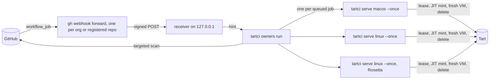

# Owner-wide runner pool

Status: **implemented** (PRs 1–4 in [Delivery](#delivery)). Discovery is
event-driven only: supervised `gh webhook forward` processes signal queued jobs
and a targeted scan decides what to serve. Nothing is polled (D16). The choices
behind the design are in [Decisions](#decisions).

## Problem

tartci serves GitHub Actions from per-repository lanes. Each lane names one
`TARTCI_RUNNER_REPO`, one golden and the exact workflows it may serve, and
`fleet-macos` profiles declare those lanes host by host. That fits a few
known repositories. It does not fit an operator who wants one Mac to serve
**every** private repository of some owners, including a personal account:

- A user account (as opposed to an organization) has no account-level
  runners, so each repository needs its own repository-scope JIT runner.
- The operator does not want to list workflow names. A job opts in through
  its `runs-on` label alone.
- New repositories should be served without editing a profile.

## Outcome

One LaunchAgent, started at login, serves queued jobs from the **private**
repositories of configured owners on three platform lanes, with a
configurable cap on concurrent jobs:

| Label | Guest | Golden | How |
| --- | --- | --- | --- |
| `macos-a64` | macOS arm64 | `owners-macos` | macOS serving lane |
| `linux-a64` | Linux arm64 | `owners-linux` | Linux serving lane |
| `linux-x64` | Linux arm64 + Rosetta | `owners-linux` | Linux lane booted with `TARTCI_LINUX_ROSETTA=1`, x64 runner |

Labels come from the lanes and are not configured. Every runner carries
`self-hosted` plus exactly one lane label. A workflow opts in with
`runs-on: [self-hosted, linux-x64]` or `runs-on: linux-x64`. A job is served
only when its labels, compared case-insensitively, are a subset of
`{self-hosted, <lane label>}` for one lane. A job that also asks for another
label (`[self-hosted, linux-x64, gpu]`) could never be taken by a pool
runner, so it is not served rather than booting a VM for it every 120 s.

`macos-x64` is out of scope: there is no x64 macOS guest on Apple silicon.

In a `linux-x64` job only the runner and the x64 binaries a step starts run
under Rosetta. The job's shell is the guest's arm64 bash: `uname -m` prints
`aarch64` while `RUNNER_ARCH` is `X64`. Use the label to get an x64 toolchain
(actions that download x64 builds, x64 Node for JavaScript actions), not to
emulate a whole x64 machine.

## Set up

Needs an Apple Silicon Mac with tartci's prerequisites (`./tartci doctor`),
a `gh` login in the keychain that is an admin of every repository to serve
(repository-scope JIT registration needs admin) and an owner of every
organization in `owners` (GitHub lets only organization owners create the
organization webhook a forwarder listens on), about 250 GB free for
the two goldens and their base images (the macOS golden is about 97 GB on
the host, its Xcode base about 89 GB, the Linux golden about 15 GB) and,
for push discovery, a second `gh` login that only the forwarders use
(step 3).

1. **The VM key and goldens.** Both goldens trust one host key,
   `~/.config/tartci/owners-vm-ed25519` (created on first use). Both build
   into `TART_HOME=~/.tart`, the store the agent uses. Export it first: the
   scripts only default it when it is unset, and the agent always uses
   `~/.tart`.

   ```bash
   export TART_HOME=~/.tart
   providers/tart-macos/owners-golden.sh            # -> owners-macos
   providers/tart-linux/owners-golden.sh            # -> owners-linux
   ```

   Both scripts pull their digest-pinned base image themselves (a no-op when
   it is already in the store). The macOS golden is Cirrus's
   `macos-golden-gate-xcode` (macOS 27, Homebrew, Xcode) pinned by digest,
   plus the pinned actions runner; the digest is the image the `:latest` tag
   resolved to when the script was written, and it is printed in the build's
   metadata line. The Linux golden is digest-pinned Ubuntu 24.04 arm64 with
   the arm64 and x64 runners, the amd64 libraries x64 binaries need, and a
   boot unit that registers Rosetta when the share is attached. Both carry
   the toolset of GitHub's hosted images, so a job that passes on a
   GitHub-hosted runner finds the same commands (see
   [Golden toolset](#golden-toolset)). No token enters either golden.
   Both scripts end by locking the VM down (see [Security](#security)).
   With the base image already pulled, a full build took about 7 minutes for
   Linux and about 6 for macOS on this pool's host. The first macOS build
   also pulls the Xcode base, about 89 GB on disk.

   To rebuild a golden, pass `--rebuild` (the macOS script also accepts
   `--force`). The new golden is built under a temporary name and swapped in
   with `tart rename` only after every step, including the lock-down checks,
   passed, so a failed rebuild leaves the pool's golden as it was. An
   interrupted swap is put back by the script's exit handler. A build killed
   outright (`kill -9`, power loss) can leave an `owners-*-build-<pid>` or
   `owners-*-old-<pid>` VM: the next run lists them and leaves them for you to
   delete. Stop the pool (`tartci owners uninstall`) before a rebuild, so no
   child clones the golden mid-swap.

2. **The host's lease budget.** Each child leases its VM from tartci's host
   lease store. Its size is a ceiling, not a reservation: the guest boots at
   the size step 4 sets per OS, but the lease charges at most `1/max_jobs` of
   the host's non-gate budget on each axis (`non_gate_capacity_cores` and
   `non_gate_capacity_mem_mb`, shown by `./tartci host-profile --json`), and a
   child waiting for capacity holds room for that share only. So `max_jobs`
   children always fit together, and `max_jobs` alone caps how many run, never
   the sum of their sizes. With no size set, a child boots at what any serve
   on this host asks: the host profile's cores (`vm_pool_cores` in the same
   output), clamped to the non-gate core budget, and memory derived from the
   cores it is granted (`providers/common/vm-lease.lib.sh`); its lease charges
   the same share. Gate leases are never discounted, so a host whose role
   reserves cores for gate jobs keeps that reserve, and the pool's shares come
   from what is left. To give the pool the whole host, release the reserve:

   ```bash
   ./tartci governor set gate_guarantee_cores=0   # optional
   ./tartci leases status        # e.g. 0/14 cores used (reserved gate 0)
   ```

3. **The forwarder login.** Discovery runs one
   `gh webhook forward` per target. Each one creates a repository or
   organization webhook, which needs `admin:repo_hook` or `admin:org_hook`.
   Those scopes go on a separate login, so the main login does not widen
   (D13):

   ```bash
   gh extension install cli/gh-webhook     # once; the dispatcher runs its binary directly
   GH_CONFIG_DIR=~/.config/tartci/gh-webhooks gh auth login --hostname github.com \
     --git-protocol ssh --skip-ssh-key --web --insecure-storage \
     --scopes admin:repo_hook,admin:org_hook
   ```

   Each part has a reason:
   - **Its own directory.** `gh` keeps one login per host in each config
     directory, so a second login needs a second directory
     (`forwarder_gh_config_dir`).
   - **`--insecure-storage`.** `gh` files keychain tokens under the host and
     the user. A second login as the same GitHub user would overwrite the main
     login's keychain entry. With `--insecure-storage` the token is written to
     that directory's `hosts.yml` (0600) instead, and the keychain is left
     alone.
   - **`GH_TOKEN`.** `gh` prefers the keychain to `hosts.yml`, so pointing
     `GH_CONFIG_DIR` at the directory is not enough: it would still find the
     main login. The dispatcher reads `oauth_token` from `hosts.yml` itself and
     passes it only as `GH_TOKEN` in each forwarder's environment. It never
     logs, prints or writes the token, and no child or VM gets it.

   `gh auth login` always adds its own minimum scopes, so this login also
   holds `repo`, `read:org` and `gist`, not only the two hook scopes. It is
   still kept away from every child and VM. Do not run `gh auth logout`,
   `refresh` or `switch` with that `GH_CONFIG_DIR`: `gh` may also act on the
   keychain entry it shares with the main login.

   `run` exits 2 at startup, as for any other configuration error, when this
   login is missing or its `hosts.yml` cannot be read: without it no forwarder
   can start, and there is no polling fallback, so the pool would serve
   nothing while looking healthy.

4. **The config,** `~/.config/tartci/owners.toml`:

   ```toml
   owners = ["theriety"]     # organizations: each is served whole by one org forwarder
   repos = ["alvis/app"]     # private owner/repo entries; a personal account's repositories go here, one by one
   exclude_repos = []
   max_jobs = 4              # concurrent jobs, 1-16
   max_macos = 2             # 0-2; Apple's guest limit is 2
   gh_cli = "gh"             # the GitHub CLI the dispatcher and its children run (default "gh")
   forwarder_gh_config_dir = "~/.config/tartci/gh-webhooks"  # the forwarder login (step 3)
   forwarder_port = 0        # the receiver's port on 127.0.0.1; 0 picks a free one
   rotate_seconds = 3600     # planned restart of each forwarder, then a catch-up; 0 off, else 600-86400
   # macos_vm_cores = 4      # child VM size per OS, cores 1-64, memory 2048-524288 MB;
   # macos_vm_mem_mb = 10240 # a key left unset leaves the lane's own sizing (step 2)
   # linux_vm_cores = 3
   # linux_vm_mem_mb = 8192

   [golden]                  # optional; these are the defaults
   macos-a64 = "owners-macos"
   linux-a64 = "owners-linux"
   linux-x64 = "owners-linux"
   ```

   `gh_cli` names the GitHub CLI the dispatcher, its reap pass and every
   child run (exported to children as `TARTCI_GH_CLI`; `install` also puts its
   directory on the agent's `PATH`). Leave it at `gh` unless the login lives
   behind a wrapper. It must authenticate from the keychain, with
   `GH_TOKEN` and `GITHUB_TOKEN` scrubbed. Unknown keys are an error, so a
   typo never silently changes behaviour.

   `push`, `reconcile_seconds` and `poll_seconds` were removed (D16): a config
   that still sets one, to any value, is refused with exit 2 and a message
   naming it (`run`, `dry-run` and `install`). Delete the line.
   `rotate_seconds` is also what re-lists the owners now: each rotation ends
   in a catch-up, which re-lists them when the last full listing is 15
   minutes old. With `rotate_seconds = 0` the owners are re-listed only when a
   forwarder re-establishes on its own (GitHub drops one every hour or two),
   and on the event-driven paths in [Discovery](#discovery).

   A personal account in `owners` is refused (`run` and `dry-run` exit 2 and
   name the account); list its private repositories in `repos` instead. See
   [Repositories](#repositories).

5. **Check, then install.**

   ```bash
   ./tartci owners dry-run       # what would be served, per owner and repo, and the forwarders it would run; starts nothing
   ./tartci owners install       # pin this commit, write and load the LaunchAgent
   ./tartci owners status        # repositories, children, child VM size, rate headroom, pinned commit
   ```

   `install` exports the checkout's committed `HEAD` (under jj, the parent of
   the working-copy change) to `~/.tartci/owners/app/<sha>/` and the agent
   runs that copy, never the working tree. To update, check out the new
   reviewed commit and run `install` again.

A workflow then opts in:

```yaml
jobs:
  build:
    runs-on: [self-hosted, linux-x64]
```

## Shape



The dispatcher, `tartci owners`:

```text
tartci owners run         # the LaunchAgent's process
tartci owners dry-run     # print what would be served, start nothing
tartci owners status      # repositories, children, headroom, pinned commit
tartci owners install     # pin a commit, write and load the LaunchAgent
tartci owners uninstall   # unload and remove it; keep goldens and config
```

It is `scripts/owners_dispatch.py` (with `scripts/owners_service.py` for the
service), run through `tartci_toml_exec` so it can read TOML, with unit tests
under `scripts/test_owners_*.py`. The name avoids the existing `fleet` and
`fleet-macos` vocabulary. [docs/agents/commands.md](agents/commands.md) has
the exact behaviour and exit codes of each subcommand.

The dispatcher decides which repository and lane needs a runner next and hands
that to `tartci serve <os> --once --repo R --labels self-hosted,<label>
--golden G`. Everything after that is tartci as it is today: lease admission,
JIT registration at repository scope (group 1), a throwaway clone, one job,
and deletion.

### Admission stays with tartci

The dispatcher adds an outer cap. It does not replace the inner one:

- `max_jobs` (default 4) bounds concurrent `serve --once` children. At most 2
  of those are macOS (`max_macos`, and never more than
  `TARTCI_MACOS_VM_CAP`). Apple's 2-guest limit and the host lease store
  still decide inside each child.
- Before starting a child, the dispatcher checks the same two gates the
  macOS lane checks, `tartci_pool_admission_open` and
  `tartci_pool_lock_absent` from `providers/common/pool.lib.sh`. While either
  is closed it starts nothing and lets running children finish, so
  `tartci pool drain` drains the pool too.
- A child refused before boot (lease denied, admission closed or the macOS
  cap full) exits without a VM, and the job stays queued. The dispatcher
  backs off that `(repo, lane)` with a growing delay instead of retrying
  every tick. A child that booted but was never given a job (120 s idle
  timeout) gets a short fixed pause instead.

### Children

- **Identity.** Each child gets its own name (`tartci-owners-…`), slot, lane
  ID and state directory under `~/.tartci/owners/state/`. macOS children
  register as `tartci-owners-<…>-<pid>-<n>`; Linux children as
  `linux-ephr-<pid>-<n>`.
- **Counting.** GitHub gives a runner any queued job whose labels match. So
  the dispatcher starts a child for a `(repo, label)` only while queued jobs
  outnumber that pair's children that are **not yet assigned** a job. A
  child counts as assigned once tartci writes its `job-running` state.
- **Idle timeout.** Children run with `TARTCI_RUNNER_IDLE_TIMEOUT_SECS=120`
  instead of the default 900, so an unclaimed macOS child does not hold one
  of only 2 slots for 15 minutes.
- **Size.** The pool fixes no VM size. Each `*_vm_cores` / `*_vm_mem_mb` key
  set in `owners.toml` reaches that OS's children as the lane's documented
  override (`TARTCI_{MACOS,LINUX}_VM_{CORES,MEM_MB}`); a key left unset passes
  nothing, so the lane sizes the VM as it does for any serve. That size is a
  ceiling: each child's lease charges a `1/max_jobs` share of the non-gate
  budget (`TARTCI_VM_LEASE_SHARE_SLOTS`, step 2), so jobs can burst to it
  without the sizes capping concurrency. `status` and `dry-run` print, per
  OS, the size its children request: the configured value, or the lane
  default that applies.
- **Environment.** Children get an allowlisted environment (`PATH`, `HOME`,
  `USER`, `LOGNAME`, `SHELL`, `TMPDIR`, `TERM`, `GH_CONFIG_DIR`,
  `XDG_CONFIG_HOME`, `TARTCI_MACOS_VM_CAP`) plus what the dispatcher sets:
  `TART_HOME=~/.tart`, the VM key, explicit state, cache and log
  directories, the VM size `owners.toml` sets, if any, and the share slot count
  (`TARTCI_VM_LEASE_SHARE_SLOTS` = `max_jobs`). No token, no ssh agent, no
  inherited `TARTCI_*`, `PULP_*`, `LANG`, `LC_*` or `TZ`.
- **Restart.** A child still alive when the dispatcher restarts is adopted
  only if its pid and recorded start time both match, and it counts against
  the caps. Anything that cannot be verified is never signalled.

### Repositories

- The served set is the **private, non-archived** repositories of `owners`,
  plus private `repos`, minus `exclude_repos`. A public repository is never
  served, even when listed by hand, and `status` reports it as refused. When
  the owners are listed again is in [Discovery](#discovery).
- **Registration (push).** An organization in `owners` gets one organization
  forwarder that covers every repository it has now or creates later. A
  personal account's repositories are served only when each is listed in
  `repos`, and each gets a repository forwarder: GitHub has no account-wide
  webhook for a user. A personal account in `owners` is refused at startup
  (a config error, exit 2) rather than ignored, so it cannot look served
  while nothing is listening for it. A `repos` entry of an organization that
  is already in `owners` needs no forwarder of its own.
- Each repository is checked before it is served: admin rights, not
  archived or disabled, and "Run workflows from fork pull requests" off. A
  repository that fails is refused and listed in `status`.

### Discovery

Events are hints and the scan stays the truth (D15). Nothing is polled (D16):
between the triggers below the dispatcher makes no REST call at all, even
while children run. The one bounded exception is the leftover-registration
reap pass (see Lifecycle): for 3 h after a child of a repository ends badly,
that repository is visited about every 90 s.

- **Hints.** Each forwarder relays its target's `workflow_job` events to the
  receiver. A `queued` event for a served repository whose labels fit a lane
  triggers a scan of that one repository. Nothing in the payload admits a job:
  the scan re-reads the runs, jobs, head repositories and settings. GitHub's
  run listings can trail the event by minutes: live, two `workflow_dispatch`
  runs were missing from the listing 17 s and 32 s after their events and
  appeared about 2 minutes later (`?status=queued` lagged longer still), and
  list answers may be up to 60 s stale (`Cache-Control: s-maxage=60`). So a
  hinted job that a clean scan does not list stays pending, and its repository
  is rescanned 15, 30, 60, 120 and 240 s apart, until 10 minutes after the
  event (at most six rescans). Before each rescan the job is read directly
  (`GET repos/{repo}/actions/jobs/{id}`, conditional): if it is in progress or
  completed (another runner took it, or it was cancelled), or answers 404 at a
  second recheck (one 404 may be lag too), the hint is settled with no rescan.
  The rescan reads each run's jobs fresh, as a run's job list can trail the
  event too. A failed scan keeps the hint (the retry rescans). A job still
  unlisted after 10 minutes is logged and left to the next catch-up. The
  direct read never serves the job: a repository's runner takes any queued job
  that fits its labels, so only a scan, which checks every active run's head
  repository first, may start a child. A repository that stops being served
  drops its hints. With nothing hinted, nothing is read. A freed slot is seen
  locally, when the child exits.
- **Guard requests.** Any `workflow_job` event (any action, any labels) of a
  repository that has children triggers the fork-head guard for it: a served
  repository is scanned (the scan checks every run's head repository before
  it serves anything), an unserved one has its runs re-read by the guard (see
  [Security](#security)). A fork run's own events (`queued`, `waiting`,
  `in_progress`) reach the dispatcher this way. Only a lane job ever starts a
  child, so an event of a hosted-runner job only costs the guard's scan. An
  event of a repository with no children that is not a lane's `queued` job
  costs nothing.
- **Catch-up.** When a forwarder is established (its signed `ping`, or 30 s
  alive without one), every served repository it covers is scanned once, so a
  job queued while it was down is served, and every repository with children
  is guarded. This happens at startup, after every restart and after every
  rotation. If the listing of the forwarder's organization (or repository)
  failed, its repositories are not all known yet: the catch-up scans those
  known and waits, and runs once more only when that listing succeeds (a
  retry that fails again rescans nothing).
- **Backlog.** Queued jobs a scan could not serve (the caps were full, a
  backoff, admission closed) are remembered per repository, and so is the
  repository of a child that exits without taking its job (a failed clone,
  JIT mint or ssh): no event says that job is still queued. Only those
  repositories are scanned again: when a child exits, when the backoff ends,
  or when admission reopens (checked locally every 10 s, no GitHub call). A
  repository that is no longer served leaves the backlog (and the retries).
- **Failed scans.** A scan that fails (a 5xx, a timeout, a rate limit) never
  drops what asked for it: the repository is scanned again after 10 s, then
  after twice that, up to 5 minutes, until a scan succeeds. A backlog entry
  whose rescan fails waits for the same retry, and so does a failed guard
  reading of an unserved repository with children (no event may come for
  it). If a whole cycle raises, its hints, guard requests and catch-ups are
  kept and tried again after the same growing delay. A 404 from a run's jobs
  means the run was deleted after the runs were listed: that run is skipped,
  the rest of the scan stands. A 404 on the repository or its runs is
  different: the repository may be deleted, renamed or no longer readable, so
  it is not served (its children expire, the fork-head guard watches them)
  and that repository alone is listed again 60 s later, so a passing 404
  costs about a minute. If it answers 404 again it waits for the next full
  listing.
- **Newly served.** After every listing, a repository that has just become
  served (its fork setting turned off, admin granted) is scanned at once.
- **Listing the owners.** In full: at startup, and on a catch-up when the
  last full listing is 15 minutes old (so about once per `rotate_seconds`;
  see the config above for `rotate_seconds = 0`). Partly: once (at most every
  60 s) when an event names a repository of an organization owner that is
  not known yet, so a new repository is served from its first queued job
  (while that owner's listing fails, the repository is asked about again at
  that listing's retry); a repository that answered 404 (above); and a
  failed listing. A listing that failed with no answer, a 5xx or a rate limit
  is retried after 10 s, then twice that, up to 5 minutes, until one
  succeeds; one GitHub refused (a 4xx such as a 403 for an organization's
  SAML SSO, or an owner that is not listable) is retried only at the next
  catch-up (a rotation or a re-establish). Either retry re-lists only what
  failed.
- **Idle cost.** An idle pool, and one whose children just run their jobs,
  make no REST calls with the main login: no scans, no listings, no reap
  pass (see [Lifecycle](#lifecycle)). Forwarder health is checked locally.
  Each hook is read over REST with the forwarder login only every 30
  minutes, or when the local check looks wrong.

A scan sends one conditional request for the repository's metadata and one
for its recent runs (`If-None-Match`, so an unchanged answer is a 304 and
costs nothing against the primary limit). For each run that is queued or in
progress it lists the queued jobs and keeps those whose labels fit one lane.
A failed scan is an error, never "0 queued", and starts nothing.

The same `gh` login also serves tartci's own lanes, so the dispatcher tracks
headroom from `X-RateLimit-Remaining`, honours `Retry-After` and secondary
limits (every scan waits until then; nothing asked for is dropped), keeps its
own requests above a floor of the remaining limit, and shows the headroom in
`status`. Across 94 repositories a dry run measured about 2 requests per
repository per scan, most of them 304s.

### Forwarders

- **One process per target.** The dispatcher runs the extension's binary
  directly, `gh-webhook forward --org O` (or `--repo R`) `--events
  workflow_job --url http://127.0.0.1:<port>/f/<target> --secret S`, in its
  own session and process group. Its environment is `PATH`, `HOME`, `TMPDIR`,
  `USER`, `LOGNAME`, the forwarder token as `GH_TOKEN`, `GH_CONFIG_DIR` and
  no prompts. Without the extension's binary it falls back to
  `gh webhook forward`. Each start creates a webhook named `cli` on GitHub,
  and GitHub deletes it within seconds of the forwarder's connection ending.
- **The receiver** is one HTTP server on `127.0.0.1` (`forwarder_port`, or a
  free port). It takes only a POST to the path of a configured target, with a
  `Content-Length` of at most 1 MiB and a valid `X-Hub-Signature-256`, an
  HMAC under a random secret made at each dispatcher start and held only in
  memory, and it gives each request 10 s to arrive. Anything else is dropped
  (401, 404, 411 or 413) and counted in `status`. It acts on `ping` and
  `workflow_job` only, and it never logs a payload. A `ping` for a target
  whose forwarder is not running is ignored, and an event for a repository
  its target does not cover is dropped.
- **Rotation.** Every `rotate_seconds` (default 3600) an up forwarder is
  restarted on purpose, before GitHub drops it, and scanned once (the
  catch-up) when its new `ping` arrives. Each target gets a fixed stagger of
  up to 10% of the period (at most 5 minutes), so the targets do not all
  rotate in the same minute. A rotation is not an error and does not back
  off; `status` counts it under `rotations`, apart from `restarts`. Set
  `rotate_seconds = 0` to leave a forwarder until it exits on its own.
- **Restart.** A forwarder that exits after running for a while is restarted
  after 5 s and catches up once it is up. GitHub drops a long-lived forwarder
  every hour or two (`close 1006`, exit 1); rotation makes these rare.
- **Backoff.** `HTTP 422 Hook already exists`, a login error, a failed start,
  or an exit within 60 s of starting or of coming up backs off 10, 20, 40,
  80, then 120 s. The ladder resets only once a forwarder has stayed up for
  60 s, so one that pings and dies again and again is held to a catch-up
  scan every 2 minutes or so. Forced restarts (a stall, a hook gone) that
  repeat within 10 minutes climb the same ladder. A planned rotation never
  counts as a failure.
- **Stale hooks.** A `cli` hook that outlived its forwarder blocks the next
  one with 422. After 60 s of 422 the dispatcher deletes that target's hook
  only if this pool recorded creating it (its id came in that target's
  `ping`, kept in `state/forwarders.json`) and its name is still `cli`. Any
  other hook is left alone, and the forwarder keeps backing off.
- **Stalls.** Every 20 s one `ps` and one `lsof` look at every forwarder's
  process group. A stopped forwarder (state `T`) is restarted at once. If its
  GitHub socket is in `CLOSE_WAIT`, or it has no `ESTABLISHED` socket, its hook
  is read over REST; if the same reading comes twice in a row, it is
  restarted. `lsof` exits 1 both when nothing matched and when it failed: an
  exit 1 with no output at all means no socket (a strike), one with a message
  on stderr is "unknown", neither a strike nor a clean reading.
  A hook that has gone from GitHub (read every 30 minutes) also restarts it.
- **Owner type.** An organization owner whose account type cannot be read at
  startup is never assumed to be an organization: its forwarder waits
  (`checking`) while the type is read again on the backoff ladder. A personal
  account found that way is `refused`, and its forwarder never starts; so is
  an account of any other type (a `Bot`...), and an organization whose type
  nothing can read. Only a failed read is retried.
- **While a target is down** nothing new is served for its repositories.
  There is no polling fallback: jobs stay queued and the catch-up serves them
  once it is back. The failure is shown in `status`. A target that cannot
  start for a login error (or an unreadable account type) is logged as DOWN,
  with "nothing is served", at once; a target that has not been up for 10
  minutes for any other reason (422 for ever, a missing `gh-webhook` binary,
  exits) is logged the same way. Either repeats at most every 10 minutes,
  and stops once the target is up.
- **No orphans.** Each forwarder's pid, process group and start time are
  recorded in `state/forwarders.json`, and so are the pid and start time of
  each other member of its group (the gh-webhook child of `gh webhook
  forward`), learned by the 20 s check from one `ps` reading (also before the
  forwarder's `ping`); a member whose start time that reading lacks is not
  recorded. Whenever `run` exits (SIGTERM, exit 75
  or an error), every forwarder group gets SIGCONT, SIGTERM and, after 3 s,
  SIGKILL. Killing only the `gh` parent would orphan its child. The next
  `run` (first thing, before it reads the configuration, and with `push =
  false` too) and `uninstall` also
  stop any recorded forwarder still alive whose pid and start time both
  match. When that leader is gone but a recorded group member still matches
  (the `gh` parent died with the dispatcher, its child kept the hook), that
  member is stopped on its own. A process whose start time does not match is
  never signalled. Logs go to `<root>/logs/forwarders/<target>.log` (0600,
  reset above 1 MiB).

`tartci owners status` shows discovery and one line per forwarder:

```text
  discovery: push via gh-webhook, receiver 127.0.0.1:52144; last scan 12s ago, last discovery 41m ago
    scans by reason: backlog=1, catchup=3, discovery=2, guard=14, hint=9; events: completed=9, queued=9; hook API calls 2
    forwarder org theriety: up, for 41m, rotates in 22m, restarts=2, rotations=5, pid=321, hook=77, last event 12s ago, last catch-up 41m ago
    forwarder repo alvis/app: backing-off, retry in 40s, restarts=5, last event never, last catch-up never
      last error: rc=1: HTTP 422: Validation Failed (...) Hook already exists on this repository
```

A forwarder's state is `checking` (its owner's account type is being read),
`starting` (waiting for its `ping`), `up` (with the time to its next
rotation), `rotating` (a planned restart, back in 5 s), `backing-off` (with
the time to its next start), `stalled` (being restarted after a stall),
`refused` (a personal account in `owners`) or `stopped`. The scan reasons are
`hint`, `guard`, `catchup`, `backlog`, `retry`, `recheck`, `discovery`,
`relist` and `newly-served`; there is no `work` cadence and no "next scan"
any more (D16), and the rate line notes a wait GitHub asked for. A `queued`
line in `status` says how old its scan is, and repositories waiting for a
retry after a failed scan are listed. A `hinted jobs` line, once there has
been one, shows the hints still pending per repository and how the others
were settled (`listed`, `taken`, `gone`, `expired`, `dropped`). The other fields are its uptime, unplanned
restarts, planned rotations, pid,
the hook id from its `ping`, its last event and last catch-up, and its last
error. Every value shown is masked: anything shaped like a `gh` token
(`gh[opsu]_…`) prints as `gh*_***`.

### Security

- **Private repositories only.** Public repositories, where fork pull
  requests can trigger workflows, are never served. Keep "Run workflows
  from fork pull requests" off for private repositories (GitHub's default).
- **Security drops.** If a served repository turns public, its fork setting
  turns on, or any non-completed run's head repository differs from the
  base repository (or is unknown), the repository is dropped at once. Its
  waiting children, and those assigned in the last 15 s, are stopped; on a
  fork-headed run the dispatcher also reads that run's jobs and stops the
  child holding one, assigned or not (every child of the repository if the
  jobs cannot be read). This guard keeps running for a dropped repository
  until its children are gone, in every cycle that runs for any reason. Other
  drops (archived, admin lost, a setting unreadable) only stop new children;
  waiting ones expire.
- **When the guard runs (D16).** The fork-head check runs on events, not on
  a timer: on any `workflow_job` event of a repository with children, on
  every catch-up, and in every cycle while a repository with children is
  unserved. A fork run's job reaches a runner only through an event GitHub
  sends to the forwarders, so while they are up that event triggers the
  check. See [Limits](#limits) for the accepted gap.
- **The GitHub token stays on the host.** The dispatcher and its children use
  the keychain `gh` login only (`GH_TOKEN` and `GITHUB_TOKEN` are scrubbed,
  so the dispatcher and children always authenticate the same way). The
  forwarder login's token goes only into the forwarders' environment, never
  into a child's or a VM's, and the dispatcher never runs `gh auth login`,
  `refresh`, `logout` or `switch`. Only
  the one-job JIT config enters a VM: it is sent over ssh stdin, read and
  deleted in the guest, and handed to the runner in its environment.
- **Key-only SSH into pool VMs.** The serving lanes reach a guest with
  `BatchMode=yes` and the pool key (`TARTCI_VM_SSH_KEY`) only. The golden
  scripts use the base images' public `admin`/`admin` password just until the
  key is installed, then, as their last step, make each guest enforce:
  - sshd refuses password and keyboard-interactive login (a drop-in,
    `/etc/ssh/sshd_config.d/00-tartci-key-only.conf` on Linux and
    `000-tartci-key-only.conf` on macOS; sshd keeps the first value it reads,
    so each sorts before the image's own drop-ins). The build fails unless
    `sshd -T` reports it effective, and then proves a key login works and a
    password login is refused.
  - on macOS, Screen Sharing and Remote Management are disabled (tcp/5900
    closed). On the base image Screen Sharing was enabled and listening.

  Not changed: the `admin` password (macOS auto-login and the login keychain
  depend on it; it now only works at the console, which has no remote path) and
  admin's passwordless `sudo`, which jobs need. A job is root in its own VM.
  The existing goldens were hardened in place with the same step. To check a
  golden, clone it, boot the clone and try `ssh -o PubkeyAuthentication=no
  admin@<ip>`: it must offer only `publickey`.
- **Network isolation.** Pool VMs share Tart's default NAT network
  (`192.168.64.0/24`); the host's `softnet` isolation is **not** used. Measured
  on this host (macOS 27.2, Tart 2.42.0), with two Linux and two macOS clones
  running at once, a guest could not reach another guest at all: neighbour
  discovery for the peer failed ("No route to host" / "Host is down"), while
  the same guest reached its gateway and the host reached every guest. So
  guest-to-guest traffic is blocked by the host's NAT here, and the key-only
  sshd above is defence in depth, not the only barrier. That property belongs
  to the host's virtual network, not to tartci: re-measure it after a macOS or
  Tart upgrade. Enforcing it independently with `tart run --net-softnet` is a
  possible follow-up (it needs a privileged helper and changes how guests reach
  the host, so it is not done here).
- **Events never admit a job.** A forged or replayed event can at most cause
  a scan of a repository that is already served. Admission, labels, fork
  heads and settings always come from the scan.
- **The receiver secret is visible in `ps`.** `gh webhook forward` takes the
  secret only as `--secret`, so any local user can read it from the process
  list while the dispatcher runs, and could then send signed requests to the
  receiver. Such a request can trigger scans, mark a forwarder up early, or
  record a hook id for a target; the stale-hook rule above would then delete
  that hook only if it is named `cli`. This is a known local exposure,
  accepted on a single-user host.
- **Pinned, no self-update.** The LaunchAgent runs an exported, recorded
  commit of this fork. `status` shows it, updating is `install` from a
  reviewed checkout, and the self-update agent is not installed.

### Lifecycle

- **GitHub unavailable.** Failing scans start nothing. After about 3 minutes
  of continuous failure (rate limits excepted: they are waited out) the
  dispatcher stops admitting children and exits 75 once no children
  remain, so launchd restarts it. The dispatcher scans a few repositories at
  a time, so one repository whose endpoint keeps failing is not enough.
  Scans run only on their triggers, so an outage is noticed on the next one
  (an event, a catch-up or a retry); with none, nothing is read and nothing
  counts.
  Only failures with no HTTP answer, or a 5xx, count (a 4xx is GitHub
  answering): scans of two different repositories must have failed so with
  no answer in between, or of every served repository, or a scan and a
  listing. Even then the outage counts only once `GET /rate_limit` (free)
  fails too; if it answers, those repositories are failing on their own and
  are only retried.
- **Login rejected.** When GitHub answers 401 to every scan of a cycle (or to
  a listing, or to `GET /rate_limit`), the main login was revoked or logged
  out. The dispatcher logs `ERR GitHub rejects the dispatcher's login (HTTP
  401): the pool is DOWN` at once and then at most every 10 minutes, until a
  scan succeeds. It does not exit for it: a restart cannot fix the login, and
  would only tear down and re-create every forwarder each time; it keeps its
  forwarders up and serves again from the first scan after `gh auth login` is
  redone.
- **One dispatcher per pool root.** `run` takes an exclusive lock on
  `state/run.lock` before anything else, before it stops a previous run's
  forwarders. A second `run` for the same root (a manual one while the
  service runs) prints which pid holds it, changes nothing and exits 3;
  under launchd that is retried every 30 s and takes over once the other
  instance has exited. The lock is released with the process, never left
  behind.
- **Logout, restart and `uninstall`.** launchd sends SIGTERM; the dispatcher
  stops its forwarders (GitHub removes their hooks within seconds) and its
  children, which delete their VMs and registrations. launchd caps
  a user agent's `ExitTimeOut` at 60 s, shorter than the dispatcher's 150 s
  child grace; children run in their own sessions, so they keep cleaning up
  after the dispatcher is gone. Jobs in flight at logout fail and can be
  re-run.
- **Startup.** The dispatcher deletes VMs left by a crash before it serves:
  only VMs named for its own children whose recorded child is gone.
- **Leftover registrations.** A crashed child leaves its JIT registration
  behind, offline. A slow reap pass visits only repositories where a child
  ended badly in the last 3 h, one every 90 s (nothing otherwise; a child
  that deferred with exit 75 before writing any state registered nothing and
  does not count; after a restart, only the previous process's children not
  recorded as ended cleanly count), skipping
  repositories with a live child and pausing while rate-limited. It runs tartci's reaper with `--runners-only --scopes
  repository` (no VM calls, no state files). What it removes, and what it can
  therefore reach:
  - **Scope.** Only **repository-scope** registrations of that one repository.
    The pool registers runners only through
    `repos/<R>/actions/runners/generate-jitconfig`, so organization runners are
    never listed or deleted, and `orgs/…` and `users/…` are never called.
  - **State.** Offline and not busy, and seen offline on 3 passes spanning at
    least 900 s (an offline clock kept per repository under `<root>/reap/`).
  - **Name.** `tartci-owners-<…>-<pid>-<n>` (a macOS child) or
    `linux-ephr-<pid>-<n>`. The second is **the name every tartci Linux lane
    uses**, not a pool-only name.
  - **Kept.** A runner carrying a `pulp-host-*` label (another host's lane) is
    never deleted.

  The reap pass visits only repositories where a child ended with an error
  or was killed in the last 3 hours, so an idle pool makes no reap calls once
  those 3 hours have passed: the one bounded exception to "no REST call
  between triggers", besides the 30-minute hook check.

  So an offline `linux-ephr-<pid>-<n>` registration left by another host, or
  by another tartci Linux lane on this host, that serves one of the same
  repositories and has no `pulp-host-*` label **can be removed** once it has
  been offline for 900 s over 3 passes. An ephemeral JIT runner is not
  expected to survive being offline that long, but run the pool only for
  repositories you do not also serve from another tartci Linux lane, or give
  those lanes a `pulp-host-*` label.

### Service

`tartci owners install` writes `~/Library/LaunchAgents/com.danielraffel.tartci.owners.plist`
with `RunAtLoad`, `KeepAlive`, `ExitTimeOut` and logs in
`~/Library/Logs/tartci/owners.{out,err}.log`, and loads it. The agent runs
`caffeinate -i` around the dispatcher (caffeinate execs it in place, so
launchd's SIGTERM reaches the dispatcher directly) so the Mac does not idle
sleep mid-job.

`KeepAlive` restarts the dispatcher whatever its exit, at most every 30 s
(`ThrottleInterval`). A configuration error exits 2, so a config that stopped
parsing (or still sets a removed key: `push`, `reconcile_seconds`,
`poll_seconds`), a personal account in `owners` or a missing forwarder login
makes it start, stop any leftover forwarders and exit 2 every 30 s, with the
reason in `owners.err.log` each time, until the config is fixed or the agent
is uninstalled. `install` refuses (exit 2, nothing changed) a config that does
not parse or sets a removed key, and a missing forwarder login, so this loop
needs a change made after `install`.

It is a LaunchAgent, not a LaunchDaemon, because Tart needs the login
keychain unlocked. With FileVault on, the pool therefore starts after the
first login following a boot.

Under launchd, macOS Local Network privacy attributes a process's network
access to the job's responsible process. The dispatcher's Python re-execs
into `Python.app`, which a background job can never get the prompt for, so
children's ssh to their VM failed with "No route to host". The dispatcher
therefore starts each child with responsibility disclaimed (`posix_spawn`
with `responsibility_spawnattrs_setdisclaim`; plain `Popen` if that symbol is
missing). Every libc call in that path is checked: a failed call raises and the
child is not started, never silently started without the disclaim. The
dispatcher logs which path is active once at startup (`spawn=disclaimed
posix_spawn` or `Popen fallback`, with a warning) and `tartci owners status`
shows it as `child spawn:`. [Gotchas](gotchas.md) has the details.

## Golden toolset

Both goldens follow GitHub's hosted runner images (actions/runner-images:
`images/ubuntu/Ubuntu2604-Readme.md` and `images/macos/macos-26-Readme.md`),
so a workflow written for `ubuntu-latest` or `macos-latest` does not need to
install the tools those images ship.

**`owners-linux`** (Ubuntu 24.04 arm64; Cirrus publishes no 26.04 image yet)
carries every tool in the Ubuntu readme that has an arm64 Linux build:
GitHub's apt package list as named on noble, gcc 13 and 14, gfortran, clang
18 with clang-format and clang-tidy, CMake, Ninja, autotools, Python 3 with
pip, pipx and venv (`python` is `python3`), git with Git LFS, jq, yq, zstd,
7-Zip, aria2, Docker CE with buildx and compose (the runner user is in the
`docker` group), Podman, Buildah, Skopeo, kubectl, Helm, Kustomize, kind,
minikube, Packer, Bazelisk (also as `bazel`), the AWS CLI with SAM and the
Session Manager plugin, the Azure CLI with `azure-devops`, azcopy, Bicep, the
Google Cloud CLI, Temurin 11, 17, 21 and 25 (default 25), Maven, Gradle, Ant,
Kotlin, Go, Rust (rustup, stable, rustfmt, clippy), Ruby, PHP with Composer,
Perl, .NET 10, PowerShell, vcpkg, nvm, ansible-core, yamllint, PostgreSQL and
MySQL (root/root), Apache and nginx (installed, services disabled, as on
GitHub), Firefox with geckodriver, and Node.js LTS with npm, npx, Yarn
classic and `gh`. On `linux-x64` these tools are arm64 and run natively; x64
binaries a job downloads (setup-* actions, pnpm's standalone binary) run
under Rosetta with the amd64 runtime libraries (libatomic, libssl, libcurl,
libffi, libicu, zlib, ...), and the x64 runner's containers default to
`linux/amd64`.

**`owners-macos`** is Cirrus's Xcode image (Xcode with its Command Line
Tools, Homebrew, Node 24 and many of GitHub's formulae), plus from Homebrew
whatever the macOS readme lists that the base lacks: yq, wget, gnu-tar,
aria2, p7zip, zstd, pipx, CMake, Ninja, pkgconf, Bazelisk, Packer, the AWS
CLI, SAM and Session Manager plugin, the Azure CLI, azcopy, Bicep,
CocoaPods, Carthage, fastlane, SwiftLint, SwiftFormat, xcbeautify, xcodes,
unxip, Temurin 11, 17, 21 and 25 (default 21), Maven, Gradle, Ant, Kotlin,
Ruby, PHP with Composer, Go, GCC, PowerShell, a .NET SDK, Google Chrome and
Firefox, and Rust through rustup.

Both set the runner environment GitHub's images set, in each runner's `.env`
(the lanes keep lines they do not own): `PATH`, `ImageOS`, `JAVA_HOME` and
`JAVA_HOME_<v>_X64` (plus `_ARM64` on Linux, `_arm64` on macOS), and
`RUNNER_TOOL_CACHE` = `AGENT_TOOLSDIRECTORY` at GitHub's path
(`/opt/hostedtoolcache`, `/Users/runner/hostedtoolcache`), writable by the
runner, so setup-* actions cache there and prebuilt tool-cache archives with
fixed prefixes work.

Not installed (ask if a workflow needs one): Google Chrome and ChromeDriver
on Linux (no arm64 Linux build), Chromium on Linux (snap-only on noble),
Microsoft Edge, Selenium server, the Android SDK and NDK, Haskell, Swift on
Linux, Homebrew on Linux, the CodeQL bundle, PHPUnit, extra .NET SDKs and
Xcode versions, and the multi-version hosted tool caches (setup-* actions
download those on demand).

Pinning: every direct download is checked against a pinned SHA-256 (the
Linux script's `TOOL_DOWNLOADS` table, including the Azure DevOps CLI
extension wheel, each value compared with the publisher's own checksum when it
was added); apt packages are verified by apt, each third-party apt key is
accepted only at its pinned fingerprint, and the Docker self-check runs
`hello-world` by digest. Homebrew bottles are checksummed by Homebrew and not
version-pinned (GitHub's image does not pin them either). The known exceptions
are pinned by version or identity instead of by hash: Yarn and the Linux pipx
tools (ansible-core, yamllint) are exact versions whose dependencies resolve
at build time, as does the pinned azure-devops wheel's one dependency
(`distro`); rustup installs the current stable toolchain and the vcpkg
bootstrap fetches its own tool; and the macOS `google-chrome` cask is
`sha256 :no_check` upstream, so the build accepts it only with a valid code
signature from a Developer ID certificate Apple issued to Google's team. Each build prints every tool's
version (`TARTCI_TOOL`, `TARTCI_BREW`, `TARTCI_CASK` lines) and fails unless
each one runs. To bump a pinned tool, change its row (version and SHA-256) and
rebuild.

## Limits

- **2 macOS jobs at once.** Apple's Virtualization framework runs at most 2
  macOS guests per host.
- **Rosetta.** Apple is removing most of Rosetta 2 in macOS 28. Re-evaluate
  the `linux-x64` lane before this host moves to macOS 28.
- **FileVault.** The pool starts at login, not at boot.
- **Logout.** Jobs in flight fail and can be re-run.
- **One host.** Each host runs its own pool against the same owners; GitHub
  hands a job to whichever runner asks first. A second host's
  forwarder for a target that already has a `cli` hook gets 422 and backs off
  without serving it.
- **Lost events.** An event sent between a forwarder's silent stall and its
  detection is lost: about 40 s for a socket the local check catches, or up
  to the 30-minute hook check for one that looks healthy (or that `lsof`
  cannot read) but receives nothing. A job queued in that window waits for
  the catch-up after the restart, or for the next event of its repository.
  An event that did arrive is not lost to a failed scan, a child that never
  took its job, a failed listing, or a run listing that trails it by up to
  10 minutes (see [Discovery](#discovery)). A job GitHub still does not list
  after that waits for the next catch-up (about an hour at the default
  `rotate_seconds`) or the next event of its repository.
- **Hook churn.** Every forwarder start creates a webhook and every stop
  deletes it. Rotation makes that about one per hour per target, plus any
  unplanned restarts, each visible in the hook settings and the audit log.
- **Rotation gap.** Between stopping a forwarder and its successor's `ping`
  (about 5–10 s, longer if the old hook lingers and the new one backs off on
  422) no event arrives; the catch-up scan serves what queued meanwhile.
- **Fork run in a forwarder gap (accepted risk, D16).** The fork-head guard
  runs on events and catch-ups only. Suppose a fork-headed run's job is queued
  while that repository's forwarder is down, stalled or rotating, in a
  repository that has a waiting child. Suppose too that its fork-PR setting
  was turned on since the last listing (less than about an hour ago, at the
  default `rotate_seconds`). GitHub can then assign the job to that waiting
  runner with no event reaching the dispatcher. The job runs in the child's
  VM until the next event of that repository or the catch-up after the gap.
  The guard then stops the child, and the next listing refuses the
  repository. The polling cadence closed this window within 10 s. It was
  given up so that no REST call is made between triggers, and the operator
  accepted the risk. Keep the fork-PR setting off on served repositories: a
  listing refuses any repository where it is on, and any scan that sees a
  fork head stops that repository's children.
- **One process per personal repository.** A personal account has no
  account-wide hook, so each registered repository runs its own forwarder.

## Remove

```bash
./tartci owners uninstall           # stop the agent, remove the plist; keep state and logs
./tartci owners uninstall --purge   # also remove the pool's app, state, logs, reap, cache, fetchcontent-src
```

`--purge` removes `app/`, `state/`, `logs/`, `reap/`, `cache/` and
`fetchcontent-src/` under the pool root (`~/.tartci/owners`, or `--root` /
`TARTCI_OWNERS_ROOT`) and `~/Library/Logs/tartci/owners.*.log`, then the root
itself if it is empty. It refuses a root that is not provably a pool's: it must
lie below `$HOME` (never `$HOME` or `~/.tartci` itself, in any letter case) and
hold `state/dispatcher.json`, `app/current` or an exported commit
(`app/<sha>/COMMIT`, which a failed first install leaves), and it checks this
before stopping anything.

`uninstall` stops any forwarder a crashed dispatcher left behind (recorded in
`state/forwarders.json`, pid and start time both matching). GitHub removes
the forwarders' hooks within seconds.

`uninstall` reports (and does not delete) any pool VM or child still present:
`tartci-owners-*` VMs, and `linux-ephr-<pid>-<n>` VMs whose `<pid>` is a child
this pool recorded in its state directory. tartci's own Linux lanes name their
VMs the same way, so a lane VM that merely shares `TART_HOME` is not reported.
A pool Linux VM whose state is gone (purged, or dropped by state retention
after 7 days or 100 children) cannot be attributed either: neither `uninstall`
nor `tartci owners run` reports or removes it, so check `tart list | grep
linux-ephr-` by hand after a purge. Neither form deletes the goldens,
`owners.toml` or the VM key.

A child that crashed leaves its runner registration on GitHub, and
`uninstall` stops the reap pass with the dispatcher. Those offline
registrations remain after uninstall; GitHub itself drops an ephemeral runner
that stays offline after about a day. To remove the goldens and config too:

```bash
tart delete owners-macos; tart delete owners-linux
rm ~/.config/tartci/owners.toml ~/.config/tartci/owners-vm-ed25519{,.pub}
rm -r ~/.config/tartci/gh-webhooks             # the forwarder login (see step 3: not gh auth logout)
./tartci governor unset gate_guarantee_cores   # restore the role's gate reserve
```

Deleting `gh-webhooks` does not revoke its token. GitHub lists it under the
same "GitHub CLI" OAuth authorization as the main login, so revoking that
authorization signs both logins out.

## Linux x64 lane

`TARTCI_LINUX_ROSETTA=1` makes the Linux serving lane boot with
`--rosetta=rosetta`, run the x64 runner from `~/actions-runner-x64`, and
check before minting a JIT config that the guest can run x64 binaries.
Without it the lane is unchanged. The pool sets it for `linux-x64` children
only.

## Delivery

Each item is a separate PR into this fork's `main`, stacked in this order:

| # | PR | Contents |
| --- | --- | --- |
| 1 | linux-rosetta | `TARTCI_LINUX_ROSETTA` in `providers/tart-linux/runner.sh`, the `owners-linux` golden, JIT config over ssh stdin, tests |
| 2 | owners-dispatcher | `scripts/owners_dispatch.py`, `tartci owners <run\|dry-run\|status>`, polling discovery (removed by D16), tests |
| 3 | owners-service | `install` / `uninstall`, LaunchAgent template, reap pass, `owners-macos` golden, this guide |
| 4 | owners-push | `scripts/owners_push.py`: forwarder supervision, localhost receiver, stale-hook cleanup; event-driven discovery in the dispatcher; tests |

PR 4 followed a probe that ran forwarders for several hours under the
separate login. GitHub dropped each one after 1–2 hours (`close 1006`, exit
1) and deleted its hook within 4 s of its process group ending. A new
forwarder for a target whose hook still existed failed with 422, and
SIGTERM to the `gh` parent alone left its child running. The supervisor's
rules follow from these. Because PR 4 adds hook scopes and deletes hooks on
GitHub, it is reviewed as a security change.

Acceptance runs on this host: a smoke workflow in a private repository runs
one job per label, and one real job runs in a private theriety repository on
a temporary branch. The checks are no more than 4 VMs at once, no more than 2
of them macOS, no VM left behind, and the pool serving again after logout
and login.

## Decisions

| ID | Decision | Rejected |
| --- | --- | --- |
| D1 | `tartci owners` command in Python, `owners.toml`, `owners-*` goldens | standalone `contrib/` script, generated `fleet-macos` lanes |
| D2 | serve private repositories only | in-VM fork hook, dispatch-only fork filter |
| D3 | count only children not yet assigned a job | count all children, one child per job ID |
| D4 | own multi-repository scan following `queue_scan.py`'s rules | label-only mode in `queue_scan.py` |
| D5 | `gh webhook forward` push (refined by D15 and D16: no polling at all) | polling only, hot/cold tiers, App webhooks, scale-set listeners |
| D6 | unique slot, name and lane ID per child | — |
| D7 | lifecycle above (never exit with children running) | — |
| D8 | admission and lock checks, pre-boot backoff, 120 s idle timeout, label subset of one lane, admin and fork-setting precheck, pinned commit | — |
| D9 | defer GitHub App webhooks and scale-set listeners until a measured need | — |
| D10 | one Linux golden, `owners-linux`, serves `linux-a64` and `linux-x64` | a separate `owners-linux-x64` golden |
| D11 | golden proofs and smoke jobs run in a dedicated private smoke repository | the fork itself |
| D12 | macOS golden from Cirrus's base image (no Xcode); superseded by D24 | an Xcode image |
| D13 | webhook forwarders use a separate, minimal-permission `gh` login | adding hook scopes to the main login |
| D14 | release the static gate reserve (made optional by D23); child sizes 4 cores / 10240 MB (macOS), 3 cores / 8192 MB (Linux), fixed sizes replaced by D20 | keep the reserve with smaller VMs |
| D15 | push events are hints for a targeted scan, never admission; one forwarder per organization owner and per registered personal repository, a personal account in `owners` refused; no interval polling (each forwarder rotated hourly, staggered, with a catch-up scan on every establish; local stall checks; REST hook checks every 30 minutes); `push = false` keeps polling (removed by D16) | reconcile polling, trusting event payloads, listing a personal account's repositories |
| D16 | no polling at all: `push`, `reconcile_seconds` and `poll_seconds` removed (a config that sets one exits 2); owners re-listed only by a catch-up when the last listing is 15 min old, plus the event-driven partial listings; the fork-head guard runs on any `workflow_job` event of a repository with children and on catch-ups, never on a timer; the residual risk of a fork run queued during a forwarder gap in a repository whose fork-PR setting was enabled since its last listing is accepted (see [Limits](#limits)) | `push = false` polling, a timed re-listing (`reconcile_seconds`), a 10 s guard cadence for repositories with children |
| D20 | child VM sizes are optional `owners.toml` keys per OS; an unset key leaves the lane's own sizing | sizes fixed in code (D14), a guard exemption for them |
| D23 | a child VM size is a ceiling, not a reservation: the guest boots at it, but its lease (and waiter) charges at most `1/max_jobs` of the non-gate budget per axis, so `max_jobs` alone caps concurrency; gate leases are never discounted | charging the full size, so the sum of the sizes limits how many children run |
| D24 | goldens carry GitHub's hosted-image toolset (see [Golden toolset](#golden-toolset)); macOS from Cirrus's Xcode image; Linux stays on Ubuntu 24.04 until Cirrus publishes 26.04 | baseline tools only, each job installing the rest |

## Open

- **Upstreaming.** Should this stay in the fork, or be offered to
  danielraffel/tartci once it has run for a while?
