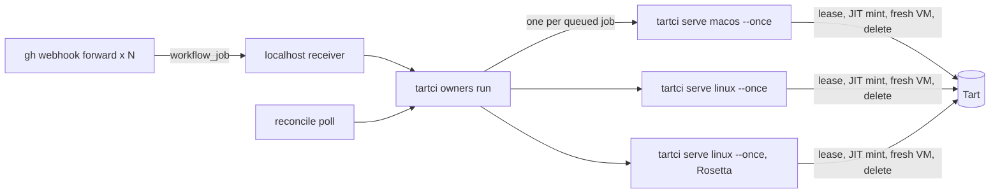

# Owner-wide runner pool (direction)

Status: **proposed**. This document sets the direction for review before any
code lands. The PRs that implement it are listed in [Delivery](#delivery), and
the choices behind it in [Decisions](#decisions).

## Problem

tartci serves GitHub Actions from per-repository lanes. Each lane names one
`TARTCI_RUNNER_REPO`, one golden and the exact workflows it may serve, and
`fleet-macos` profiles declare those lanes host by host. That fits a few
known repositories. It does not fit an operator who wants one Mac to serve
**every** private repository of some owners, including a personal account:

- A user account (as opposed to an organization) has no account-level
  runners, so each repository needs its own repository-scope JIT runner.
- The operator does not want to list workflow names. A job opts in through
  its `runs-on` label alone.
- New repositories should be served without editing a profile.

## Outcome

One LaunchAgent, started at login, serves queued jobs from the **private**
repositories of configured owners on three platform lanes, with a
configurable cap on concurrent jobs:

| Label | Guest | How |
| --- | --- | --- |
| `macos-a64` | macOS arm64 | existing macOS serving lane |
| `linux-a64` | Linux arm64 | existing Linux serving lane |
| `linux-x64` | Linux arm64 + Rosetta | Linux lane booted with `--rosetta`, x64 runner |

Labels come from the lanes and are not configured. Every runner carries
`self-hosted` plus exactly one lane label. A workflow opts in with
`runs-on: [self-hosted, linux-x64]` or `runs-on: linux-x64`. A job is served
only when its labels, compared case-insensitively, are a subset of
`{self-hosted, <lane label>}` for one lane. A job that also asks for another
label (`[self-hosted, linux-x64, gpu]`) could never be taken by a pool
runner, so it is not served rather than booting a VM for it every 120 s.

`macos-x64` is out of scope: there is no x64 macOS guest on Apple silicon.

## Shape



The new piece is a dispatcher, `tartci owners`:

```text
tartci owners run         # the LaunchAgent's process
tartci owners dry-run     # print what would be served, start nothing
tartci owners status      # repositories, forwarders, children, headroom, commit
tartci owners install     # write and load the LaunchAgent
tartci owners uninstall   # unload and remove it; keep goldens and config
```

It is `scripts/owners_dispatch.py`, run through `tartci_toml_exec` so it can
read TOML, with unit tests under `scripts/test_owners_*.py`. The name avoids
the existing `fleet` and `fleet-macos` vocabulary.

The dispatcher decides which repository and lane needs a runner next and hands
that to `tartci serve <os> --once --repo R --labels self-hosted,<label>
--golden G`. Everything after that is tartci as it is today: lease admission,
JIT registration at repository scope (group 1), a throwaway clone, one job,
and deletion.

### Admission stays with tartci

The dispatcher adds an outer cap. It does not replace the inner one:

- `max_jobs` (default 4) bounds concurrent `serve --once` children. At most 2
  of those are macOS, and never more than `TARTCI_MACOS_VM_CAP`. Apple's
  2-guest limit and the host lease store still decide inside each child.
- Before starting a child, the dispatcher checks the same two gates the
  macOS lane checks: `tartci_pool_admission_open` (participation and
  `pool-state`) and `tartci_pool_lock_absent` (the transition lock), both in
  `providers/common/pool.lib.sh`. They are shell functions, so the dispatcher
  runs them through a small `bash` call that sources that file. While either
  is closed it starts nothing and lets running children finish.
- A child refused before boot (lease denied, admission closed or the macOS
  cap full) exits 1 or 75 without a VM. The job stays queued. The dispatcher
  treats any exit before the child's VM state appears as a denial and backs
  off that `(repo, lane)` with a growing delay instead of retrying every tick.

### Children

- **Identity.** Each concurrent child gets its own `TARTCI_RUNNER_SLOT`,
  `TARTCI_RUNNER_NAME` (always starting `tartci-`, so tartci's reaper
  recognizes it) and `TARTCI_QUEUE_LANE_ID`. Without them, two macOS
  children share one slot, and one child's ghost sweep can delete the
  other's freshly minted registration (`providers/tart-macos/runner.sh`).
- **Counting.** GitHub gives a runner any queued job whose labels match. So
  the dispatcher starts a child for a `(repo, label)` only while queued jobs
  outnumber that pair's children that are **not yet assigned** a job. A
  child counts as assigned once tartci writes its `job-running` state.
- **Idle timeout.** Children run with `TARTCI_RUNNER_IDLE_TIMEOUT_SECS=120`
  instead of the default 900. A child exists only because a job was queued,
  and an unclaimed macOS child would otherwise hold one of only 2 slots for
  15 minutes.
- **Size.** The pool fixes no VM size. `owners.toml` may set
  `macos_vm_cores`, `macos_vm_mem_mb`, `linux_vm_cores` and `linux_vm_mem_mb`;
  each one set reaches that OS's children as the lane's documented override
  (`TARTCI_{MACOS,LINUX}_VM_{CORES,MEM_MB}`). A key left unset passes
  nothing, so the lane sizes the VM as it does for any serve: cores from the
  host profile, memory derived from the granted cores
  (`providers/common/vm-lease.lib.sh`). The host lease store admits each
  child at that size.

### Repositories

- The served set is the **private, non-archived** repositories of `owners`,
  plus private `repos`, minus `exclude_repos`. It is listed again every 15
  minutes. A public repository is never served, even when listed by hand,
  and `status` reports it as refused. Every scan and every delivery also
  checks `repository.visibility == "private"` (not `private`, which is also
  true for internal repositories), so a repository made public stops being
  served at once, and its forwarder is stopped.
- Repository-scope JIT registration needs admin rights. The dispatcher checks
  them per repository before serving it, together with the setting "Run
  workflows from fork pull requests", which must be off. A repository that
  fails either check is excluded and listed in `status`. This avoids tartci's denial receipts, which block a key until a
  person clears them.

### Discovery

Push first, polling as the fallback:

1. **Push.** The dispatcher supervises one
   `gh webhook forward --events=workflow_job --url=http://127.0.0.1:<port>/
   --secret <s>` per alvis repository and one `--org` forwarder per
   organization (today 55 + 1). Each one holds an outbound WebSocket to
   GitHub and relays `workflow_job` deliveries to a receiver bound to
   localhost. The receiver checks the signature, and a `queued` action marks
   the repository for an immediate scan. The forwarder is a public-beta
   extension (`cli/gh-webhook`). It needs the `admin:repo_hook` and
   `admin:org_hook` scopes, and creates a webhook named `cli` on each
   repository or organization. Forwarders run under their own
   `GH_CONFIG_DIR` login that holds those scopes, so the main `gh` login,
   which tartci and its lanes use, does not widen. The `--org` forwarder
   starts only when that login is an owner of the organization.
2. **Own hooks only.** Before and after starting a forwarder, the
   dispatcher lists the repository's or organization's hooks and records the
   ID of the `cli` hook it created. It deletes only hooks it recorded: when
   its forwarder dies uncleanly, before a restart, and on `uninstall`. If a
   start fails with "Hook already exists" on a hook it did not create (for
   example a teammate forwarding the organization), it leaves that hook
   alone, polls that repository or organization at 10 s, and names it in
   `status`.
3. **Reconcile poll.** Every repository is still scanned: every 60 s while
   its forwarder is healthy, and every 10 s while it is down. If every
   forwarder is down, that is about 560 conditional requests a minute for 93
   repositories, plus one job-list call per active run, against the roughly
   900-a-minute secondary limit. The same `gh` login also serves tartci's
   own lanes, and every non-304 response counts against the 5,000-an-hour
   primary limit. The dispatcher therefore computes headroom from
   `X-RateLimit-Remaining` as well as its own request count, widens the
   interval on its own below 25% headroom, and shows both in `status`.
4. **Scan.** A scan sends one conditional request for the repository's
   recent runs (`If-None-Match`, so an unchanged answer is a 304). For each
   run that is `pending`, `queued` or `in_progress`, it lists the queued
   jobs and keeps those carrying exactly one lane label. It follows
   `scripts/queue_scan.py`'s rules without reusing that module, which needs
   workflow names and runs one lane per process. A failed scan is `ERR`,
   never 0, and starts nothing.

Push is a hint and the scan is the truth: a missed or duplicated delivery
costs at most one reconcile interval and never starts an extra child.

### Security

- **Private repositories only.** Public repositories, where fork pull
  requests can trigger workflows, are never served. Keep "Run workflows
  from fork pull requests" off for private repositories (GitHub's default).
  As defence in depth, the scan still skips any run whose head repository
  differs from the base repository, or is null.
- **The GitHub token stays on the host.** The dispatcher and tartci use the
  existing `gh` login (`TARTCI_GH_CLI`); the forwarders use their own (see
  Discovery). Only the one-job JIT config enters a VM, exactly as today.
- **Webhook secret.** The secret is generated per run. GitHub stores it in the
  hook's configuration, and it is visible to local processes on the
  forwarder's command line. That is acceptable because a delivery is only a
  hint to scan; it never starts a child by itself.
- **Pinned, no self-update.** The LaunchAgent runs a recorded, reviewed
  commit of this fork. `status` shows it, updating is a manual checkout, and
  the self-update agent is not installed.

### Lifecycle

- **GitHub unavailable.** Scans that fail report `ERR` and start nothing.
  Unlike tartci's lanes, the dispatcher may have children running jobs, and
  if its process exits, launchd tears down their process group with it. So
  after about 3 minutes of continuous failure it stops admitting children and
  restarts its forwarders and receiver. It exits 75, so launchd restarts it
  with fresh credentials, only once no children remain.
- **Logout and restart.** SIGTERM reaches every child and forwarder. The
  plist's `ExitTimeOut` gives children time to delete their VMs. Jobs in
  flight at logout fail and can be re-run.
- **Startup.** The dispatcher removes VMs left by a crash before it starts
  serving: those named for its own children whose child process is gone.
  Leftover runner registrations are not removed at startup, because tartci's
  reaper deletes one only after 3 passes and 900 s offline, and per
  repository (`scripts/vm_reap.py`). An unused JIT registration expires on
  GitHub's side, and the dispatcher's periodic reap pass covers the served
  repositories over time.

### Configuration

`~/.config/tartci/owners.toml`:

```toml
owners = ["alvis", "theriety"]
repos = []                # extra private owner/repo entries
exclude_repos = []
max_jobs = 4
poll_seconds = 10         # reconcile interval while push is down
reconcile_seconds = 60    # reconcile interval while push is healthy
push = true               # supervise gh webhook forward
# macos_vm_cores = 4       # child VM size per OS; unset: the lane's own sizing
# macos_vm_mem_mb = 10240
# linux_vm_cores = 3
# linux_vm_mem_mb = 8192

[golden]
macos-a64 = "owners-macos:latest"
linux-a64 = "owners-linux:latest"
linux-x64 = "owners-linux-x64:latest"
```

### Service

`tartci owners install` writes and loads a per-user LaunchAgent with
`RunAtLoad`, `KeepAlive`, `ExitTimeOut` and logs under
`~/Library/Logs/tartci/`. The agent wraps the dispatcher in
`caffeinate -i` so the Mac does not sleep mid-job.

It is a LaunchAgent, not a LaunchDaemon, because Tart needs the login
keychain unlocked. With FileVault on, the pool therefore starts after the
first login following a boot.

## Linux x64 lane

The Linux serving lane boots without `--rosetta` today. Only the on-demand
cross lane passes it. Delivery adds an opt-in, `TARTCI_LINUX_ROSETTA=1`,
which boots with `--rosetta=rosetta`. The `owners-linux-x64` golden adds the
x64 `actions-runner` on top of the Linux golden. tartci's Linux provisioning
already registers Rosetta binfmt and installs amd64 runtime libraries.

Known limit: Apple is removing most of Rosetta 2 in macOS 28. The x64 lane
must be re-evaluated before this host moves to macOS 28.

## Delivery

Each item is a separate PR into this fork's `main`, stacked in this order:

| # | PR | Contents |
| --- | --- | --- |
| 1 | linux-rosetta | `TARTCI_LINUX_ROSETTA` in `providers/tart-linux/runner.sh`, tests |
| 2 | owners-dispatcher | `scripts/owners_dispatch.py`, `tartci owners <run\|dry-run\|status>`, polling discovery, tests |
| 3 | owners-service | `install` / `uninstall`, LaunchAgent template, lifecycle, documentation |
| 4 | owners-push | `gh webhook forward` supervision, localhost receiver, stale-hook cleanup, tests |

PR 4 starts with a probe that runs every forwarder (about 56) together for
several hours. It measures disconnects and reconnects, checks that
`workflow_job` deliveries arrive, and includes a dispatcher restart and a
forwarder SIGKILL to prove that only recorded hooks are cleaned up. If the
probe fails, the pool ships with polling every 10 s, and push is revisited
on a measured need. Because PR 4 adds hook scopes and deletes hooks on
GitHub, it is reviewed as a security change.

Acceptance runs on this host. A `fleet-smoke` workflow runs one job per
label, and one real job runs in a private theriety repository on a temporary
branch. The checks are no more than 4 VMs at once, no more than 2 of them
macOS, no VM left behind, and the pool serving again after logout and login.

## Decisions

| ID | Decision | Rejected |
| --- | --- | --- |
| D1 | `tartci owners` command in Python, `owners.toml`, `owners-*` goldens | standalone `contrib/` script, generated `fleet-macos` lanes |
| D2 | serve private repositories only | in-VM fork hook, dispatch-only fork filter |
| D3 | count only children not yet assigned a job | count all children, one child per job ID |
| D4 | own multi-repository scan following `queue_scan.py`'s rules | label-only mode in `queue_scan.py` |
| D5 | `gh webhook forward` push with reconcile polling | polling only, hot/cold tiers, App webhooks, scale-set listeners |
| D6 | unique slot, name and lane ID per child | — |
| D7 | lifecycle above (never exit with children running) | — |
| D8 | admission and lock checks, pre-boot backoff, 120 s idle timeout, label subset of one lane, admin and fork-setting precheck, pinned commit | — |
| D9 | defer GitHub App webhooks and scale-set listeners until a measured need | — |

## Open for review

- **One Linux golden or two.** Could `linux-a64` and `linux-x64` share one
  golden that carries both runner archives?
- **Upstreaming.** Should this stay in the fork, or be offered to
  danielraffel/tartci once it has run for a while?
